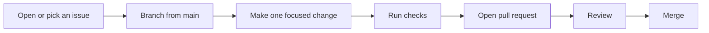

# Contributing to CaseLens

CaseLens helps people check evidence before it affects a case. Contributions should keep that promise: clear sources, honest labels, and humans in charge.

## How a change moves



## Ground rules

| Do | Do not |
| --- | --- |
| Use fictional sample data | Commit client files, personal data, keys, tokens or `.env.local` |
| Label data as Sample, Live or Unavailable | Blend demo and API data silently |
| Keep source, location and a quote on high impact findings | Present an AI answer as verified because it looks polished |
| Treat a missing match as a follow up question | Claim something did not happen because it was not found |
| Describe measured results with numbers | Claim an improvement that has not been measured |

For a large change, open an issue first so we can agree on the shape of the work.

## Local setup

Requires Node.js 20.9 or newer and npm.

```bash
git clone https://github.com/kiranShamsHere/CaseLens-AI.git
cd CaseLens-AI
npm install
cp .env.example .env.local
```

Open `.env.local` and add credentials from your own Supabase project. Add your own Gemini API key if you want AI generated answers. Never use credentials shared privately by another contributor or the project owner.

Then start the dev server:

```bash
npm run dev
```

Open [http://127.0.0.1:3000](http://127.0.0.1:3000).

| Variable | Needed for |
| --- | --- |
| `NEXT_PUBLIC_SUPABASE_URL` | Auth and database |
| `NEXT_PUBLIC_SUPABASE_PUBLISHABLE_KEY` | Auth and database |
| `GEMINI_API_KEY` | Optional AI answers. Without it Ask AI is retrieval only |
| `GEMINI_MODEL` | Optional. Defaults to `gemini-3.8-flash` |

Google sign in requires a Google OAuth client configured in your own Google Cloud project and in your Supabase Google provider settings. Email and password authentication can be configured independently.

Run `supabase/schema.sql` in your own Supabase project first. The full setup is in the [README](README.md#quick-start).

Never put a secret in a `NEXT_PUBLIC_` variable. Next.js sends those to the browser.

## Where things live

| If you are changing | Look in |
| --- | --- |
| A page | `src/app/(workspace)/` |
| An API route | `src/app/api/` |
| File extraction | `src/lib/documents.ts` |
| Conflict or missing info checks | `src/lib/findings.ts` |
| Passage ranking | `src/lib/retrieval.ts` |
| Database tables or policies | `supabase/schema.sql` |
| Shared UI | `src/components/ui.tsx` |
| Frontend API handling | `src/components/api.ts`, `src/components/demo-data.ts` |

## Branches and commits

| Item | Convention | Example |
| --- | --- | --- |
| Branch | `type/short-name` | `feature/case-filters`, `fix/mobile-review-layout`, `docs/readme` |
| Commit | Conventional Commits | `feat: add conflict filter`, `fix: handle empty PDF`, `docs: update setup` |

Common types: `feat`, `fix`, `docs`, `refactor`, `test`, `chore`. Write what changed and why, not just "update".

## Checks before a pull request

```bash
npm run lint
npm run typecheck
npm run test:backend
npm run build
```

| Change type | Also do |
| --- | --- |
| UI | Check narrow and wide screens, light and dark theme, keyboard focus, reduced motion |
| Extraction or findings | Add or update a test in `tests/backend/` |
| Database | Update `supabase/schema.sql`, keep it safe to rerun, keep row level security on |
| API contract | Update the API table in the README and the adapter in `src/components/api.ts` |

If you touch ownership or policies, test with two accounts. Account B must not read, update or delete Account A's case.

## Design conventions

| Area | Guidance |
| --- | --- |
| Look | Calm and readable: warm neutrals, restrained gold accents, legible type, soft borders |
| Responsive | Dense information needs a clear reading order on small screens |
| Accessibility | Visible focus states, keyboard operable controls, respect reduced motion |
| Language | Invite follow up. Avoid certainty the record does not support |
| Dependencies | Avoid adding one for a small need the current stack already covers |

## Pull request checklist

- [ ] Solves one described problem, with a clear summary
- [ ] Lint, typecheck, backend tests and build pass
- [ ] Checked on mobile and desktop where relevant
- [ ] Light and dark theme and keyboard focus considered for UI changes
- [ ] Sample content is fictional. No secrets or real client data
- [ ] Evidence and review states stay honest and traceable
- [ ] Screenshots or a short recording for visual changes
- [ ] README and API notes updated if behavior or contracts changed

## Reporting a security or privacy concern

Do not post confidential material in a public issue. Contact the maintainers privately with a short description and steps to reproduce. This prototype is not approved for real client data. If something was exposed by accident, report it quickly.

## Questions

Open a GitHub issue. Include the route or component, what you expected, what happened, and the smallest example you can share safely.
