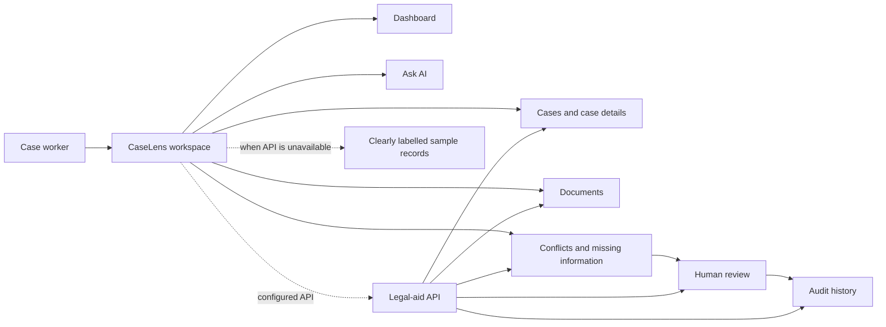

# CaseLens AI

**A clearer way to work through a messy case file.**

CaseLens is a casework interface concept for small legal-aid teams. It brings case records, documents, evidence checks, open questions, and review activity into one workspace. The central idea is simple: a useful finding should point back to the material that supports it, and a person should be able to check it before it affects a case.

This repository contains the **frontend prototype** built for the Build for Campus 2026 challenge HS-0030. It can run on sample records without a server and can read from a compatible API when one is available. It does not currently include document ingestion, OCR, an AI service, authentication, or a production backend. Sample records are demonstrations, not real client matters.

## At a glance

- **For:** case workers at small legal-aid organizations
- **Problem:** relevant facts are spread across long PDFs, chat logs, spreadsheets, and scanned forms
- **Approach:** organize matter records and make evidence, uncertainty, and human review visible in one place
- **Status:** frontend prototype; backend integration is expected through the API routes described below
- **Stack:** Next.js, React, TypeScript, Tailwind CSS, Lucide

## The problem we are working on

A case worker may need to compare a date from an intake form with a letter, locate a missing notice, or check whether two documents report different figures. In a small nonprofit, that work is often manual. Information gets revisited, source context is easy to lose, and a polished summary can look more certain than the underlying record.

CaseLens is designed around three practical questions:

1. **What needs attention?** See active matters, pending review, conflicts, and missing information.
2. **Where did this come from?** Keep a finding connected to a named source and, where supplied, a page or row.
3. **Who checked it?** Provide a review path and an audit surface for decisions.

## Product principles

- **Evidence before assertion.** High-impact information should have a traceable source, not just a generated sentence.
- **Uncertainty stays visible.** A missing document is a question to follow up, not proof that an event did not happen.
- **People stay responsible for decisions.** The interface supports review; it does not make legal judgments.
- **Sample data says so.** When the API is absent, the workspace labels illustrative records instead of presenting them as live case data.
- **Work should survive a poor connection.** The frontend aims to stay light and keep its sample workspace usable offline. Full offline document processing and synchronization require backend and device testing and are not claimed as implemented here.

## How the prototype fits together



The current app is the workspace layer in that diagram. The API is an integration boundary, not a service included in this repository.

## What you can explore

| Area | What it is for |
| --- | --- |
| Dashboard | A high-level view of matters, review work, conflicts, missing information, and activity |
| Cases | Search case records, open a matter, and try the new-case flow |
| Documents | Inspect the document workspace and its source-oriented presentation |
| Ask AI | Explore the question-and-answer surface; without a connected service it reports the API error rather than inventing an answer |
| Conflicts | Review potentially inconsistent details and the sources associated with them |
| Review center | Provide a human checkpoint for flagged information |
| Audit logs | Inspect activity records and distinguish sample history from live API history |
| Settings | View workspace preferences, including the light/dark appearance |

The current sample dataset includes a few fictional cases and illustrative findings. Some dashboard summaries remain demonstrative when the backend is not connected. Check the page-level “Sample”, “Live”, or unavailable indicators before interpreting a number as operational data.

## Evidence and review model

The intended evidence record is more than a conclusion. A useful review item should include:

| Field | Example |
| --- | --- |
| Finding | Employment start date differs between records |
| Source | Intake form and employer letter |
| Location | Page 2 and page 1, when available |
| Supporting material | Short quotation or extracted value |
| State | Pending, needs review, accepted, or corrected |
| Reviewer activity | Who checked the item and what changed |

This prototype demonstrates parts of that workflow with sample data. It does not independently verify source files or guarantee that a real backend provides complete provenance. A missing match should prompt follow-up with the client or the original source.

## Run it locally

### Requirements

- Node.js 20.9 or newer
- npm

### Install and start

```bash
git clone https://github.com/ghulamebilal-dev/caselens-ai.git
cd caselens-ai
npm install
```

Create `.env.local` in the repository root if you want to configure an API:

```env
# Leave empty to request same-origin /api routes.
NEXT_PUBLIC_API_BASE_URL=
```

Start the development server:

```bash
npm run dev
```

Open [http://127.0.0.1:3000](http://127.0.0.1:3000).

To use a separately hosted API, set `NEXT_PUBLIC_API_BASE_URL` to its origin, for example `https://api.example.org`. The frontend currently calls `/api/...` paths on that origin. This variable is public and must never contain a secret.

### Production build

```bash
npm run lint
npm run typecheck
npm run build
npm start
```

## API integration

The frontend adapter is in [`src/components/api.ts`](src/components/api.ts). Current screens request these paths:

| Path | Used for |
| --- | --- |
| `GET /api/cases` | Case list and dashboard case counts |
| `POST /api/cases` | Create a case |
| `GET /api/cases/:id` | Case details |
| `GET /api/documents` | Document collection and dashboard count |
| `GET /api/conflicts` | Conflict list and dashboard count |
| `GET /api/missing` | Missing-information list and dashboard count |
| `GET /api/review` | Review queue |
| `GET /api/audit` | Audit activity |
| Ask AI route | Question submission; see the request in `src/app/(workspace)/ask/page.tsx` |

Collection responses may be a bare JSON array, an object with the expected collection key (such as `cases`), or an object with a `data` array. Case records are normalized in [`src/components/demo-data.ts`](src/components/demo-data.ts). Confirm these shapes, error behavior, authentication, CORS, and pagination with the backend team before connecting real records. There is no shared backend contract in this repository yet.

When a collection request fails, the relevant page may show sample content with an unavailable/sample label. The API adapter does not merge server records with sample records. Ask AI handles failure separately and does not fabricate an answer.

## Challenge evaluation plan

The challenge asks for measurable improvement against a documented baseline. We do **not** claim a measured improvement yet: this repository has no completed user study or recorded timing results. A fair next evaluation should compare the existing manual workflow with the prototype using the same case packet and tasks.

Suggested protocol:

1. Prepare a consented, de-identified packet with PDFs, a spreadsheet, chat excerpts, and at least one scanned form. Record the answer key and source locations before testing.
2. Ask case workers to locate a fixed set of facts, identify seeded contradictions, and list information that is not present.
3. Run the same tasks once with the team’s documented manual process and once with CaseLens. Counterbalance the order where possible.
4. Record task completion time, correct facts found, correct source locations, missed conflicts, unsupported claims, and reviewer corrections.
5. Report participant count, task definitions, failures, and raw aggregate results. Do not count a faster unsupported answer as an improvement.

Primary measures:

- **Evidence retrieval accuracy:** correct facts with the correct source location / all requested facts.
- **Conflict recall:** seeded contradictions correctly flagged / all seeded contradictions.
- **Unsupported-output rate:** claims without adequate source evidence / all claims shown.
- **Review correction rate:** high-impact items changed or rejected by the reviewer / items reviewed.
- **Time on task:** elapsed time to complete the fixed packet tasks.

Keep the packet fictional or properly de-identified. Do not upload confidential client records to a public demo or an unapproved AI service.

## Project structure

```text
src/
  app/
    (workspace)/       Workspace routes: dashboard, cases, documents, review, etc.
    globals.css         Theme, layout, responsive, and motion styles
    layout.tsx          Root document and metadata
  components/
    api.ts              Fetch adapter and collection response handling
    demo-data.ts        Clearly illustrative fallback records and normalizers
    layout/             Shared application shell and navigation
    ui.tsx              Reusable interface components
public/                 Static brand assets
```

## Responsible use and current limits

CaseLens is a prototype, not legal advice, a case-management system of record, or a substitute for a case worker’s judgment. The current repository has no authentication or authorization layer, no backend persistence, no OCR or document parser, no AI inference service, and no production-grade offline synchronization. Do not enter real client information into a publicly accessible deployment. A real deployment needs access controls, secure storage, retention and deletion policies, audit integrity, threat modeling, and review by the organization responsible for client data.

## Contributing

Small, reviewable changes are welcome. See [CONTRIBUTING.md](CONTRIBUTING.md) for the local workflow, design conventions, and pull request checklist.

## License

No license has been added yet. Unless the repository owner publishes one, all rights remain with the copyright holder; do not assume the code is available for reuse or redistribution.
