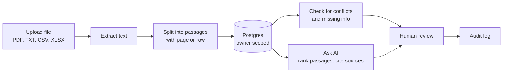
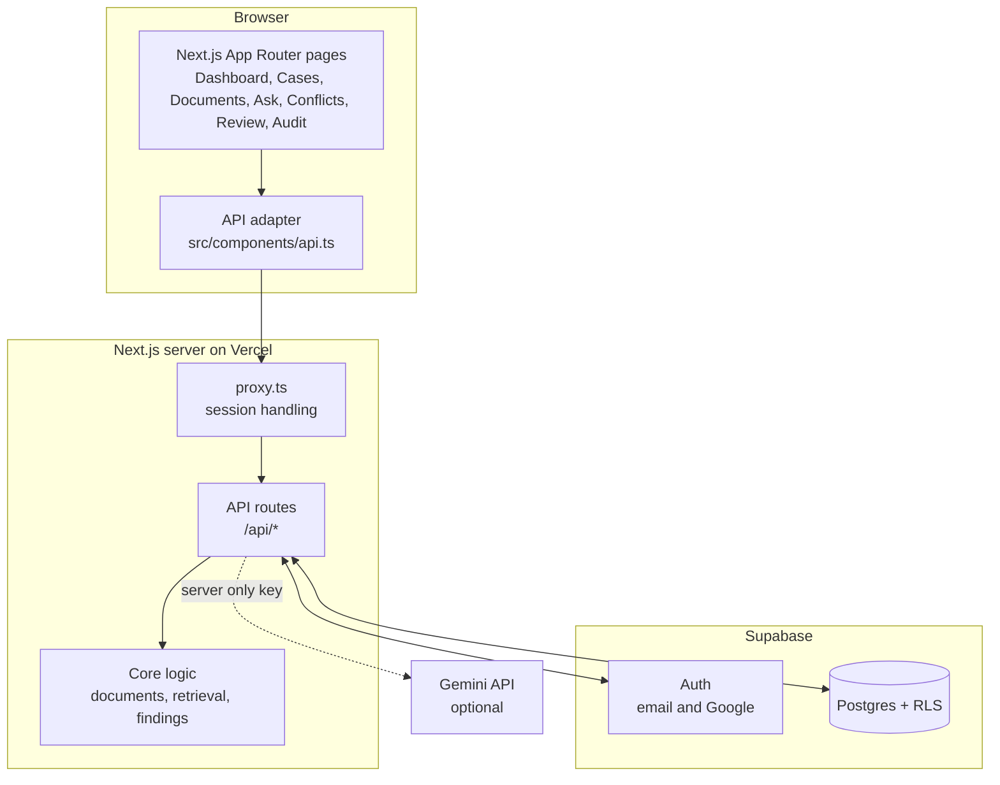
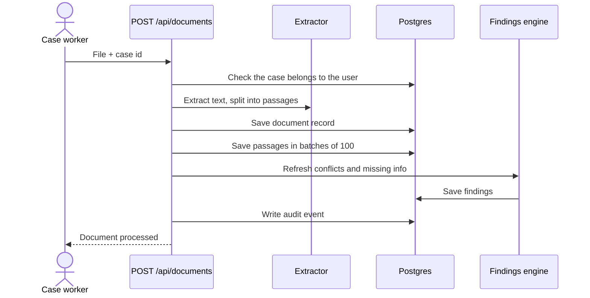
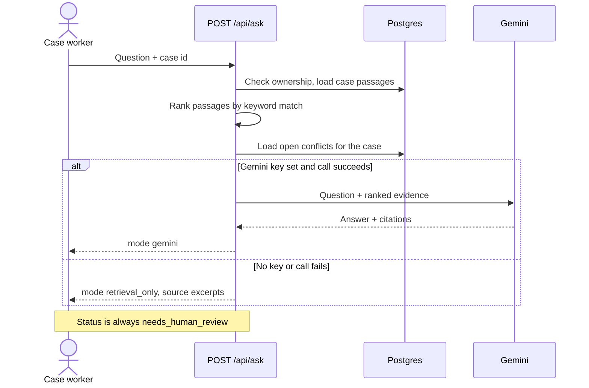
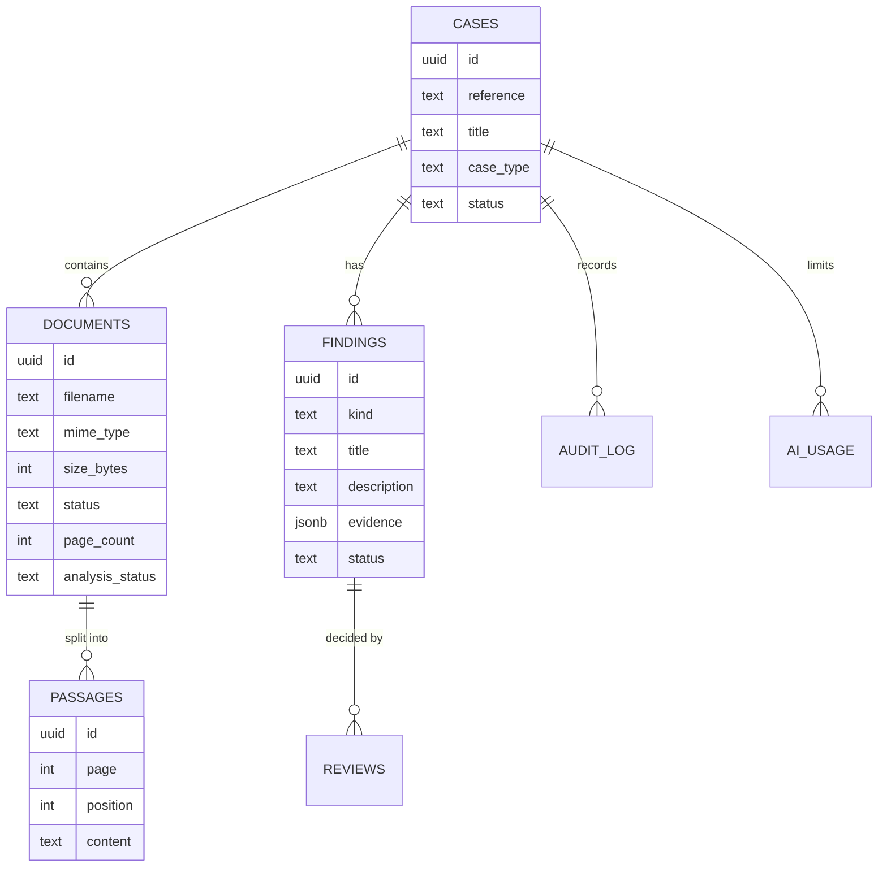
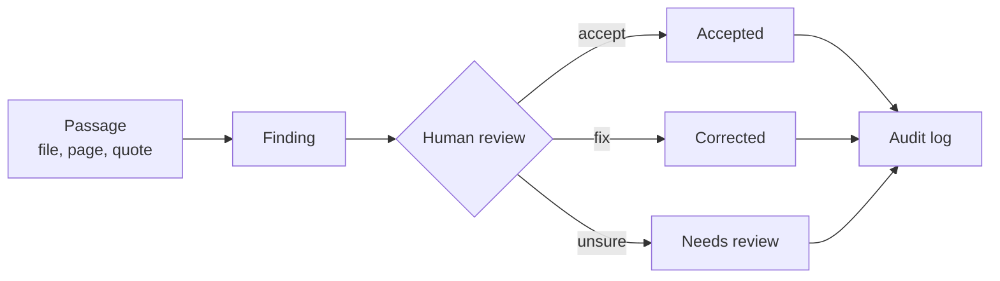

<div align="center">

# CaseLens AI

**Every finding points back to its source. Every decision has a human behind it.**

An evidence first workspace for small legal aid teams.
Built for Build for Campus 2026, challenge HS-0030.

[](https://caselens-ai-omega.vercel.app)


[Live demo](https://caselens-ai-omega.vercel.app) · [Architecture](#architecture) · [Quick start](#quick-start) · [API](#api-reference) · [Contributing](CONTRIBUTING.md)

</div>

---

## The story

Picture a case worker at a small legal aid office. The client's file is a pile of PDFs, a payroll spreadsheet, a few chat exports and one scanned form. A single question lands on the desk:

> *"Did the client start work on the date the employer says?"*

The answer is somewhere in that pile. It takes an hour to find, and nobody can tell later where it came from.

CaseLens is built for that hour. It extracts text from supported files, keeps the exact passages, flags details that disagree, and answers questions with citations. A person reviews every flag, and the decision is logged.

> The people in this story are fictional. All sample records in the app are demonstrations, not real client matters.

---

## What it does

| Question | How CaseLens answers it |
| --- | --- |
| **What needs attention?** | Dashboard of active cases, pending reviews, conflicts and missing information |
| **Where did this come from?** | Findings can include the file name, page or row, and supporting quotes |
| **Who checked it?** | Human review with notes, plus an audit trail per case |

### Principles

| Principle | In practice |
| --- | --- |
| Evidence before assertion | Answers cite passages. No source, no claim |
| Uncertainty stays visible | A missing document is a follow up question, never proof an event did not happen |
| People decide | The tool supports review. It does not make legal judgments |
| Honest about data | Pages are labelled Sample, Live or Unavailable |

---

## How it works



---

## Features

| Area | What you can do |
| --- | --- |
| Dashboard | See cases, review work, conflicts, missing information and recent activity |
| Cases | Search, open and create matters |
| Documents | Upload files and see processing status and notes |
| Ask AI | Ask a question about one case and get cited passages |
| Conflicts | Compare details that disagree, with source quotes |
| Review | Accept or correct a flagged item and leave a note |
| Audit | Read the activity history for a case |
| Settings | Light and dark appearance |

---

## Architecture



### Request flow: upload



### Request flow: ask



### Data model



| Table | Purpose |
| --- | --- |
| `cases` | One record per matter, owned by a user |
| `documents` | File metadata and processing status. Original files are not stored |
| `passages` | Extracted text with page or row position |
| `findings` | Detected conflicts and missing information, with evidence |
| `reviews` | Human decision and note for a finding |
| `ai_usage` | Per account request counting for Ask AI |
| `audit_log` | Who did what, and when |

Row level security is enabled on all seven tables, with owner only policies.

---

## Tech stack

| Layer | Choice |
| --- | --- |
| Framework | Next.js 16 (App Router), React 19 |
| Language | TypeScript |
| Styling | Tailwind CSS 4, lucide icons |
| Auth and data | Supabase Auth and Postgres with row level security |
| AI | Gemini API, optional, server side only |
| File parsing | `unpdf` for PDF, `exceljs` for XLSX |
| Validation | Zod |
| Tests | `tsx` with the Node test runner |
| Hosting | Vercel |

---

## Evidence and review



| Detection | How it works today |
| --- | --- |
| Salary conflict | Finds pay lines, normalises currency and amount, flags differing values |
| Employment start or end date conflict | Finds dated start and end lines, normalises the date, flags differing values |
| Missing information | Checklist gaps flagged for follow up |

These checks are conservative keyword heuristics. They will miss things. A person must verify every flag.

---

## Security and privacy

| Area | Status |
| --- | --- |
| Authentication | Email and password, Google OAuth through Supabase |
| Data isolation | Row level security, owner only policies on every table |
| Secrets | Gemini key is server only. Only the Supabase URL and publishable key are public |
| Uploaded files | Text and metadata are stored. Original files are not |
| Ask AI limits | Basic per account request limit |
| Review | Not security reviewed. Not approved for real client data |

> Use fictional or properly de-identified records on any public deployment.

---

## API reference

All routes except `/api/health` need a signed in user.

| Method and path | Purpose |
| --- | --- |
| `GET /api/health` | Configuration status, no credentials exposed |
| `GET /api/cases` · `POST /api/cases` | List and create cases |
| `GET /api/cases/:id` | Read a case by UUID or reference |
| `GET /api/documents?caseId=` · `POST /api/documents` | List documents, upload and extract a file |
| `GET /api/conflicts?caseId=` | Detected conflicts with source quotes |
| `GET /api/missing?caseId=` | Missing information flags |
| `GET /api/review` · `POST /api/review` | Pending findings, save a decision and note |
| `GET /api/audit?caseId=` | Case activity history |
| `POST /api/ask` | Ranked passages, optional Gemini answer with citations |
| `POST /api/analyze` | Refresh conflict and missing information flags |

Responses use collection objects such as `{ "cases": [...] }`.

---

## Quick start

### Two setups, kept separate

| Setup | Who | Credentials |
| --- | --- | --- |
| Live demo | Visitors | Owner configured on Vercel. Nothing to set up |
| Local or self hosted | Developers | Your own Supabase project and Gemini key |

No credentials are included in this repository.

### 1. Clone and install

Requires Node.js 20.9 or newer.

```bash
git clone https://github.com/kiranShamsHere/CaseLens-AI.git
cd CaseLens-AI
npm install
```

### 2. Configure environment

Copy `.env.example` to `.env.local` and fill in your own values.

| Variable | Required | Notes |
| --- | --- | --- |
| `NEXT_PUBLIC_SUPABASE_URL` | Yes | Supabase project URL |
| `NEXT_PUBLIC_SUPABASE_PUBLISHABLE_KEY` | Yes | Publishable key only. Never a secret or service key |
| `GEMINI_API_KEY` | No | Server only. Without it, Ask AI uses retrieval only mode |
| `GEMINI_MODEL` | No | Default `gemini-3.8-flash`. Use a model available to your key |
| `NEXT_PUBLIC_API_BASE_URL` | No | Leave empty to use this app's own `/api` routes |

### 3. Set up Supabase

1. Create a project at [database.new](https://database.new).
2. Open **SQL Editor**, paste all of `supabase/schema.sql` and run it. It is safe to rerun.
3. Copy the **Project URL** and **Publishable key** from **Project Settings → API Keys**.
4. Under **Authentication → URL Configuration**, set:
   * **Site URL:** the main URL you are using right now (local, or your own production domain). It is a single default value.
   * **Redirect URLs:** the callback URL for every environment you use. You can allow several at the same time.

| Environment | Redirect URL |
| --- | --- |
| Local | `http://127.0.0.1:3000/auth/callback` |
| Your production deployment | `https://YOUR-DOMAIN/auth/callback` |

You do not need to change the Site URL every time you switch environments, as long as the redirect URL is allowed. Use the same host in the browser as in the URL, so cookies match.

For local testing, you can disable email confirmation in your own Supabase project to allow immediate registration. For a publicly accessible deployment, set up email delivery through SMTP if you want verified accounts. Google sign in works independently of email confirmation.

### 4. Optional: Gemini

Create a key at [Google AI Studio](https://aistudio.google.com/apikey) and add it as `GEMINI_API_KEY`. Never use the `NEXT_PUBLIC_` prefix.

### 5. Optional: Google sign in

1. Create a Web OAuth client in [Google Cloud Console](https://console.cloud.google.com/apis/credentials).
2. Add the callback URL shown in Supabase under **Authentication → Sign In / Providers → Google** as an Authorized redirect URI.
3. Paste the client ID and secret into Supabase. Do not put them in this repo or in Vercel.

### 6. Run

```bash
npm run dev
```

Open [http://127.0.0.1:3000](http://127.0.0.1:3000) and register at `/register`.

### Deploy to Vercel

Add the Supabase variables (and the Gemini ones if you want AI answers) under **Settings → Environment Variables** for Production, Preview and Development, then redeploy.

---

## Scripts

| Command | What it does |
| --- | --- |
| `npm run dev` | Dev server on 127.0.0.1:3000 |
| `npm run lint` | ESLint |
| `npm run typecheck` | TypeScript check |
| `npm run test:backend` | Backend tests |
| `npm run build` | Production build |
| `npm start` | Run the production build |

---

## Project structure

```text
src/
  app/
    (workspace)/        Dashboard, cases, documents, ask, conflicts, review, audit, settings
    api/                Route handlers: analyze, ask, audit, cases, conflicts,
                        documents, health, missing, review
    auth/callback/      Supabase auth callback
    login/ register/ reset-password/
    privacy/ terms/ page.tsx
  components/
    auth/ landing/ layout/ theme/
    api.ts              Fetch adapter
    demo-data.ts        Labelled sample records and normalisers
    offline.ts          Offline helpers
    ui.tsx              Shared UI components
  lib/
    api-utils.ts        Auth, ownership and audit helpers
    contracts.ts        Shared response types
    documents.ts        Text extraction and passage splitting
    findings.ts         Conflict and missing information checks
    retrieval.ts        Passage ranking and quote check
    supabase/           Browser, server and config clients
supabase/schema.sql     Tables and row level security
tests/backend/          Backend tests
proxy.ts                Session handling
```

---

## Evaluation plan

No measured improvement is claimed yet. This repository has no completed user study or timing results.

| Step | Plan |
| --- | --- |
| Packet | De-identified or fictional case packet with PDFs, a spreadsheet, chat excerpts and a scanned form. Answer key written first |
| Tasks | Find fixed facts, spot seeded contradictions, list what is missing |
| Method | Same tasks with the manual process and with CaseLens. Alternate the order |
| Report | Participant count, tasks, failures and raw results |

| Measure | Definition |
| --- | --- |
| Retrieval accuracy | Correct facts with correct source / all requested facts |
| Conflict recall | Seeded contradictions flagged / all seeded contradictions |
| Unsupported output rate | Claims without adequate source / all claims shown |
| Review correction rate | Items changed or rejected by a reviewer / items reviewed |
| Time on task | Time to finish the fixed tasks |

A faster answer with no source does not count as an improvement.

---

## Current limits and roadmap

| Not included yet | Notes |
| --- | --- |
| OCR | Scanned PDFs are flagged as needing OCR |
| Original file storage | Only extracted text and metadata are kept |
| Larger files | 4 MB per file on the current Vercel path |
| Wider conflict checks | Today: salary and employment dates |
| Team sharing | Cases belong to one owner |
| Abuse protection | Only a basic per account Ask AI limit |
| Security review | Not done |
| Full automated tests | Backend tests only |

CaseLens is not legal advice and not a case system of record.

---

## Contributing

Small, focused changes are welcome. Read [CONTRIBUTING.md](CONTRIBUTING.md) first.

## License

No license has been added yet. Until one is published, all rights remain with the copyright holder. Please do not treat the code as open source.
