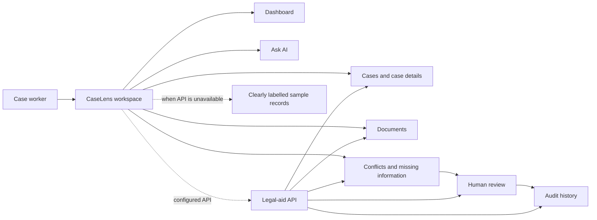

# CaseLens AI

**A clearer way to work through a messy case file.**

CaseLens is a casework interface concept for small legal-aid teams. It brings case records, documents, evidence checks, open questions, and review activity into one workspace. The central idea is simple: a useful finding should point back to the material that supports it, and a person should be able to check it before it affects a case.

This repository contains the CaseLens workspace and a server-side backend foundation for the Build for Campus 2026 challenge HS-0030. It includes Supabase email/password auth, Google OAuth, owner-scoped Postgres tables, case and document routes, text extraction, evidence retrieval, optional Gemini answers, human review, and audit events. First-time setup still requires a Supabase project, database schema, environment variables, and Google OAuth credentials. Sample records are demonstrations, not real client matters.

## At a glance

- **For:** case workers at small legal-aid organizations
- **Problem:** relevant facts are spread across long PDFs, chat logs, spreadsheets, and scanned forms
- **Approach:** organize matter records and make evidence, uncertainty, and human review visible in one place
- **Status:** working app code; deploy configuration and provider credentials are still required
- **Stack:** Next.js App Router, TypeScript, Supabase Auth/Postgres, Tailwind CSS, Gemini API

## The problem we are working on

A case worker may need to compare a date from an intake form with a letter, locate a missing notice, or check whether two documents report different figures. In a small nonprofit, that work is often manual. Information gets revisited, source context is easy to lose, and a polished summary can look more certain than the underlying record.

CaseLens is designed around three practical questions:

1. **What needs attention?** See active matters, pending review, conflicts, and missing information.
2. **Where did this come from?** Keep a finding connected to a named source and, where supplied, a page or row.
3. **Who checked it?** Provide a review path and an audit surface for decisions.

## Product principles

- **Evidence before assertion.** High-impact information should have a traceable source, not just a generated sentence.
- **Uncertainty stays visible.** A missing document is a question to follow up, not proof that an event did not happen.
- **People stay responsible for decisions.** The interface supports review; it does not make legal judgments.
- **Sample data says so.** When the API is absent, the workspace labels illustrative records instead of presenting them as live case data.
- **Work should survive a poor connection.** The frontend aims to stay light and keep its sample workspace usable offline. Full offline document processing and synchronization require backend and device testing and are not claimed as implemented here.

## How the prototype fits together



The app and API routes in this repository provide the workspace and a first working service layer. Connecting a Supabase project supplies authentication and persistent records; adding a Gemini key enables generated answers while keeping source retrieval available without it.

## What you can explore

| Area | What it is for |
| --- | --- |
| Dashboard | A high-level view of matters, review work, conflicts, missing information, and activity |
| Cases | Search case records, open a matter, and try the new-case flow |
| Documents | Inspect the document workspace and its source-oriented presentation |
| Ask AI | Explore the question-and-answer surface; without a connected service it reports the API error rather than inventing an answer |
| Conflicts | Review potentially inconsistent details and the sources associated with them |
| Review center | Provide a human checkpoint for flagged information |
| Audit logs | Inspect activity records and distinguish sample history from live API history |
| Settings | View workspace preferences, including the light/dark appearance |

The current sample dataset includes a few fictional cases and illustrative findings. Some dashboard summaries remain demonstrative when the backend is not connected. Check the page-level “Sample”, “Live”, or unavailable indicators before interpreting a number as operational data.

## Evidence and review model

The intended evidence record is more than a conclusion. A useful review item should include:

| Field | Example |
| --- | --- |
| Finding | Employment start date differs between records |
| Source | Intake form and employer letter |
| Location | Page 2 and page 1, when available |
| Supporting material | Short quotation or extracted value |
| State | Pending, needs review, accepted, or corrected |
| Reviewer activity | Who checked the item and what changed |

This prototype demonstrates parts of that workflow with sample data. It does not independently verify source files or guarantee that a real backend provides complete provenance. A missing match should prompt follow-up with the client or the original source.

## Run it locally

### Requirements

- Node.js 20.9 or newer
- npm

### Install and start

```bash
git clone https://github.com/ghulamebilal-dev/caselens-ai.git
cd caselens-ai
npm install
```

Copy `.env.example` to `.env.local` and add your Supabase project URL and publishable key. Add the Gemini key if you want AI-generated answers:

```env
# Supabase > Project Settings > API Keys
NEXT_PUBLIC_SUPABASE_URL=https://YOUR_PROJECT_REF.supabase.co
NEXT_PUBLIC_SUPABASE_PUBLISHABLE_KEY=sb_publishable_...

# Optional; without it Ask AI uses keyword retrieval and cites source passages.
GEMINI_API_KEY=...
GEMINI_MODEL=gemini-3.8-flash
```

Start the development server:

```bash
npm run dev
```

Open [http://127.0.0.1:3000](http://127.0.0.1:3000).

`NEXT_PUBLIC_API_BASE_URL` can be left empty because the API routes run in this Next.js app. Only the Supabase URL and publishable key are public. Keep `GEMINI_API_KEY` server-side and never add a Supabase service-role/secret key to any `NEXT_PUBLIC_` variable.

## Supabase setup and deployment

1. Create a project at [Supabase](https://database.new). Choose a region near your users and save the database password somewhere private.
2. In the project dashboard, open **SQL Editor → New query**. Paste the full contents of [`supabase/schema.sql`](supabase/schema.sql) and run it. This creates the cases, documents, extracted passages, findings, reviews, and audit tables with row-level security. Re-run the script if needed; it is written to be repeatable.
3. Open **Project Settings → API Keys** (or the project **Connect** dialog). Copy the **Project URL** and **Publishable key**. Put them in `.env.local` for local work.
4. In Supabase **Authentication → URL Configuration**, set the Site URL to your local origin while developing (for example `http://localhost:3000`) and add these Redirect URLs:
   - `http://localhost:3000/auth/callback`
   - `https://YOUR-VERCEL-DOMAIN/auth/callback`
   - Your Vercel preview domain pattern if you use preview deployments.
5. In Vercel, open the project **Settings → Environment Variables**. Add `NEXT_PUBLIC_SUPABASE_URL` and `NEXT_PUBLIC_SUPABASE_PUBLISHABLE_KEY` for Production, Preview, and Development. Add `GEMINI_API_KEY` there only if enabling Gemini; set `GEMINI_MODEL` to `gemini-3.8-flash` or another model available to your key. Redeploy after changing variables.
6. Visit `/register` to create an account. The first signup may require email confirmation, depending on the Supabase Auth setting. Sign in at `/login`; workspace routes and API requests require a valid session.

### Get the Gemini API key

Open [Google AI Studio API keys](https://aistudio.google.com/apikey), create or select a project, and create an API key. Add it as `GEMINI_API_KEY` in Vercel and local `.env.local`. It is only read by the server; never use the `NEXT_PUBLIC_` prefix. If no Gemini key is configured, Ask AI still does local keyword retrieval and displays source excerpts, clearly marked as retrieval-only rather than an AI answer.

### Enable Google sign-in

1. Create a Web OAuth client in [Google Cloud Console](https://console.cloud.google.com/apis/credentials). Configure the consent screen and add your test users if the app remains in Testing mode.
2. For the OAuth client's Authorized redirect URI, use the callback URL shown in Supabase **Authentication → Sign In / Providers → Google**. It looks like `https://YOUR_PROJECT_REF.supabase.co/auth/v1/callback`.
3. Copy the client ID and secret into Supabase's Google provider settings and enable Google. Do not put either provider secret in this repository or Vercel environment variables.

The Google button is wired in the app, but OAuth cannot complete until its provider credentials and allowed callback URLs are configured in your own accounts.

### Database and privacy notes

The app stores extracted text passages and file metadata in Postgres; it does not persist original uploaded files. PDF, TXT, CSV and XLSX are supported up to 4 MB per file on the current Vercel request path. Scanned PDFs without selectable text are identified as needing OCR; OCR is not implemented. Evidence retrieval works without Gemini. Conflict and missing-information checks are conservative heuristics and must be checked by a person. The schema gives each case an owner and uses RLS policies to isolate users' records.

### Production build

```bash
npm run lint
npm run typecheck
npm run test:backend
npm run build
npm start
```

## API integration

The frontend adapter is in [`src/components/api.ts`](src/components/api.ts). Current screens request these paths:

| Path | Used for |
| --- | --- |
| `GET /api/health` | Configuration status without exposing credentials |
| `GET /api/cases`, `POST /api/cases` | List and create the signed-in user's cases |
| `GET /api/cases/:id` | Read an owned case by UUID or reference |
| `GET /api/documents?caseId=…`, `POST /api/documents` | List documents or extract a supported upload into source-linked passages |
| `GET /api/conflicts?caseId=…` | Read detected contradictory facts with source quotes |
| `GET /api/missing?caseId=…` | Read checklist gaps flagged for human follow-up |
| `GET /api/review`, `POST /api/review` | Read pending findings and save a human decision and note |
| `GET /api/audit?caseId=…` | Read case audit activity |
| `POST /api/ask` | Rank passages from the selected case; optionally call Gemini and return source citations |
| `POST /api/analyze` | Refresh conservative conflict and missing-information flags for an owned case |

Routes return collection objects such as `{ "cases": [...] }`, use Supabase's cookie-based authenticated session, and apply owner isolation through row-level security. Case records are normalized in [`src/components/demo-data.ts`](src/components/demo-data.ts). All API routes except the health check require an authenticated user.

When a collection request fails, the relevant page may show sample content with an unavailable/sample label. The API adapter does not merge server records with sample records. Ask AI handles failure separately and does not fabricate an answer.

## Challenge evaluation plan

The challenge asks for measurable improvement against a documented baseline. We do **not** claim a measured improvement yet: this repository has no completed user study or recorded timing results. A fair next evaluation should compare the existing manual workflow with the prototype using the same case packet and tasks.

Suggested protocol:

1. Prepare a consented, de-identified packet with PDFs, a spreadsheet, chat excerpts, and at least one scanned form. Record the answer key and source locations before testing.
2. Ask case workers to locate a fixed set of facts, identify seeded contradictions, and list information that is not present.
3. Run the same tasks once with the team’s documented manual process and once with CaseLens. Counterbalance the order where possible.
4. Record task completion time, correct facts found, correct source locations, missed conflicts, unsupported claims, and reviewer corrections.
5. Report participant count, task definitions, failures, and raw aggregate results. Do not count a faster unsupported answer as an improvement.

Primary measures:

- **Evidence retrieval accuracy:** correct facts with the correct source location / all requested facts.
- **Conflict recall:** seeded contradictions correctly flagged / all seeded contradictions.
- **Unsupported-output rate:** claims without adequate source evidence / all claims shown.
- **Review correction rate:** high-impact items changed or rejected by the reviewer / items reviewed.
- **Time on task:** elapsed time to complete the fixed packet tasks.

Keep the packet fictional or properly de-identified. Do not upload confidential client records to a public demo or an unapproved AI service.

## Project structure

```text
src/
  app/
    (workspace)/       Workspace routes: dashboard, cases, documents, review, etc.
    globals.css         Theme, layout, responsive, and motion styles
    layout.tsx          Root document and metadata
  components/
    api.ts              Fetch adapter and collection response handling
    demo-data.ts        Clearly illustrative fallback records and normalizers
    layout/             Shared application shell and navigation
    ui.tsx              Reusable interface components
public/                 Static brand assets
```

## Responsible use and current limits

CaseLens is not legal advice, a case-management system of record, or a substitute for a case worker’s judgment. This code provides basic authentication, owner-level database isolation, text extraction and evidence-linked routes, but it has not had a security review or legal-aid organization approval. OCR, durable original-file storage, team sharing, IP-level abuse protection, production email delivery, and comprehensive automated tests are not included. Ask AI has a basic per-account request limit, not a full abuse-prevention system. Do not upload real or confidential client files to a public deployment until the organization has reviewed security, retention, access, and AI-provider data handling. Use fictional records for demos.

## Contributing

Small, reviewable changes are welcome. See [CONTRIBUTING.md](CONTRIBUTING.md) for the local workflow, design conventions, and pull request checklist.

## License

No license has been added yet. Unless the repository owner publishes one, all rights remain with the copyright holder; do not assume the code is available for reuse or redistribution.
